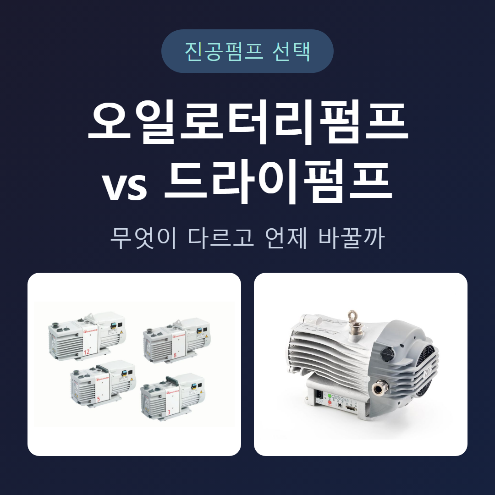
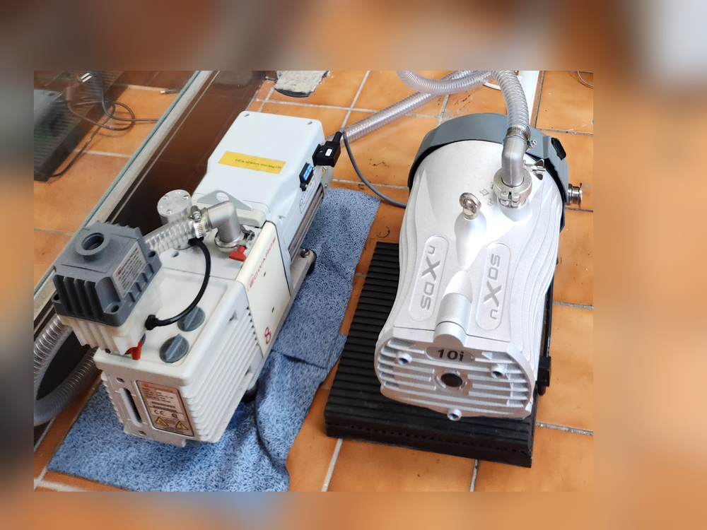
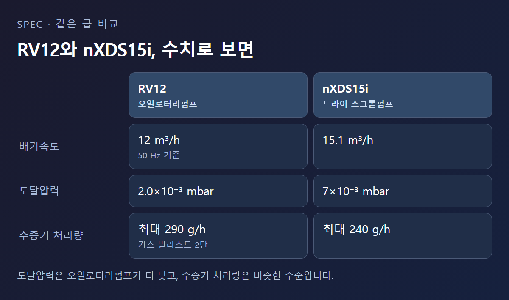

<!-- 수치검증: A항목 8개 확인(RV12 12 m³/h·2.0×10⁻³ mbar·290 g/h, nXDS15i 15.1 m³/h·7×10⁻³ mbar·240 g/h, nXDS 정비 주기 최대 5년, 흡입 밸브 0.4초 = Edwards RV·nXDS 제품 자료) / B항목 0개(해당없음) / C항목 3개 확인(RV=오일식 로터리베인, nXDS=드라이 스크롤, GXS=드라이 스크류 — product_master_table) / D항목 3개 확인(가스 발라스트·밀폐 구조·씰 퍼지 = 제품 자료) / 삭제 2개(오일 교환 주기 수치·소비전력 비교 — 원문 미확인) / 교체 0개 -->

# 오일로터리펌프와 드라이펌프, 무엇이 다르고 언제 바꿔야 할까

오일로터리펌프와 드라이펌프의 차이는 한 가지에서 출발한다. 가스가 지나가는 길에 오일이 있느냐 없느냐다. 오일이 있으면 더 낮은 압력까지 내려가고 구조가 단순하지만 오일을 관리해야 하고, 오일이 없으면 공정이 깨끗하지만 그만큼 정밀한 부품에 의존한다. 이 글은 두 펌프의 구조 차이, 같은 급 모델의 실제 수치, 그리고 지금 쓰는 오일펌프를 드라이펌프로 바꿀지 판단하는 기준을 정리한다. 대상은 실험실과 소형 설비에서 많이 쓰는 수십 m³/h 이하의 펌프다.

## 차이는 오일이 가스와 만나는가에 있다

오일로터리펌프는 회전하는 로터와 베인이 가스를 가두어 압축하는 펌프이고, 그 틈을 오일이 메운다. 스마텍이 Edwards 자료(8 top tips for working with oil-sealed rotary vane pumps, https://www.edwardsvacuum.com/en-uk/vacuum-pumps/knowledge/applications/working-with-oil-sealed-rotary-vane-pumps)를 확인한 결과, 오일은 로터와 베인 사이를 밀봉하고, 베인과 스테이터 사이를 밀봉하고, 로터의 열을 바깥으로 옮기고, 금속 부품을 가스로부터 보호하는 네 가지 일을 하는 것으로 확인된다. 오일이 밀봉과 냉각을 함께 맡는 구조다.

대신 배기하는 가스가 오일과 직접 닿는다. 이 때문에 두 가지가 따라온다. 하나는 오일이 배기 가스와 함께 미스트로 빠져나간다는 점이고, 다른 하나는 가스에 섞인 수분이나 용제가 오일에 녹아 들어 오일이 나빠진다는 점이다. 배기 쪽에 미스트 필터를 달아도 걸러내는 효율이 100%는 아니다.

드라이펌프는 가스가 지나는 공간에 오일을 쓰지 않는다. 소형에서 가장 흔한 드라이 스크롤펌프는 소용돌이 모양의 판 두 장이 맞물려 돌면서 가스를 가운데로 밀어 압축한다. 베어링에는 윤활제가 있지만 진공 쪽과 완전히 밀폐돼 있어, 진공 쪽이 윤활제로 오염되지 않고 베어링도 공정 가스로 오염되지 않는다.

## 같은 급 펌프를 수치로 비교하면

스마텍이 Edwards RV·nXDS 제품 자료(https://www.edwardsvacuum.com/en-us/vacuum-pumps/our-products/oil-rotary-vane-pumps-two-stage/rv)의 기술 데이터를 확인한 결과, 용량이 비슷한 두 모델의 수치는 다음과 같다.

- **배기속도**: 오일로터리 [RV12](https://www.smartechvacuum.com/products/edwards-rv12)는 12 m³/h(50 Hz 기준), 드라이 스크롤 [nXDS15i](https://www.smartechvacuum.com/products/edwards-nxds15i)는 15.1 m³/h
- **도달압력**: RV12는 2.0×10⁻³ mbar, nXDS15i는 7×10⁻³ mbar
- **수증기 처리량**: RV12는 가스 발라스트를 2단으로 열었을 때 최대 290 g/h, nXDS15i는 최대 240 g/h

읽는 방법은 이렇다. 도달압력은 오일로터리펌프가 더 낮다. 더 깊은 진공이 필요한 용도에서는 이 차이가 의미가 있다. 반면 수증기 처리량은 두 펌프가 비슷한 수준이다. "드라이펌프는 수분에 약하다"고 단정할 일은 아니며, 두 펌프 모두 가스 발라스트를 갖추고 있다. 수치는 모델마다 다르므로 실제 선정에서는 해당 모델의 자료를 따로 확인한다.

## 관리해야 하는 것이 다르다

오일로터리펌프의 관리는 오일이 중심이다. 오일 양과 색을 보고, 오염되면 교환하고, 배기 쪽 미스트 필터를 관리하고, 폐오일을 처리해야 한다. 오일이 나빠지면 도달압력도 함께 나빠지므로, 오일 상태가 곧 펌프 성능이다. 오일 미스트 필터를 고르는 기준은 [미스트필터 선택 기준](https://www.smartechvacuum.com/blog/77) 글에 따로 정리해 두었다. 대신 구조가 단순해 정비하기 쉽고, 구입 가격도 대체로 드라이펌프보다 낮다.

펌프가 진공 상태에서 갑자기 멈추면 오일이 장비 쪽으로 거슬러 올라갈 수 있다는 점도 오일펌프에서만 생기는 일이다. RV 시리즈는 정지 후 0.4초 안에 흡입 밸브가 닫혀 이를 막는다. 오일 증기가 장비 쪽으로 이동하는 현상은 [백스트리밍의 원리와 방지 방법](https://www.smartechvacuum.com/blog/76) 글에서 다뤘다.

드라이펌프는 오일을 보충하거나 교환하거나 버릴 일이 없다. 그렇다고 정비가 없는 펌프는 아니다. 스크롤펌프는 팁씰과 베어링이 교체 부품이다. nXDS는 정비 주기가 최대 5년으로 안내돼 있지만, 이 기간은 사용 조건에 따라 달라진다. 분진이 들어오는 공정이라면 흡입 쪽 필터를 함께 검토한다.

## 언제 드라이펌프로 바꿔야 할까

지금 쓰는 오일로터리펌프에 아래 네 가지 가운데 해당하는 것이 있다면 교체를 검토할 만하다.

1. **오일이 공정이나 제품에 닿으면 안 될 때.** 코팅, 반도체 공정처럼 미량의 오일도 불량으로 이어지는 장비가 여기에 해당한다. 트랩으로 줄일 수는 있어도 0으로 만들 수는 없다.
2. **오일 교환 주기가 계속 짧아질 때.** 수분이나 용제가 오일에 녹아 들어 금방 탁해지는 공정이라면, 오일 값과 교환 시간, 그때마다 멈추는 시간을 합쳐서 비교해야 한다.
3. **배기 오일 미스트나 폐오일을 처리하기 어려운 곳일 때.** 클린룸, 환기가 어려운 실험실, 폐유 처리 절차가 까다로운 사업장이 그렇다.
4. **펌프를 살펴볼 사람이 없을 때.** 오일펌프는 누군가 오일 상태를 주기적으로 봐야 한다. 드라이펌프도 점검은 필요하지만 손이 가는 횟수가 적다.

## 오일로터리펌프를 계속 쓰는 편이 나은 경우

반대로 다음에 해당하면 오일로터리펌프를 유지하는 것이 합리적이다.

- **더 낮은 도달압력이 필요할 때.** 위 비교처럼 같은 급에서는 오일로터리펌프가 더 낮은 압력까지 내려간다.
- **수분이 많은 일반 용도일 때.** 동결건조, 추출, 여과, 겔 건조 같은 용도는 가스 발라스트에 오일 리턴 부속과 미스트 필터를 더한 오일로터리펌프가 오래 써 온 영역이다.
- **오일 관리가 이미 자리 잡혀 있고 문제가 없을 때.** GC 같은 분석 장비는 오일로터리펌프가 지금도 널리 쓰이며, 역류 방지 장치와 미스트 필터로 충분히 대응하는 경우가 많다. 문제가 없는 펌프를 드라이라는 이유만으로 바꿀 필요는 없다.
- **초기 비용이 우선일 때.** 다만 오일, 필터, 폐유 처리, 정지 시간까지 더한 몇 년 치 비용으로 비교해야 공정한 비교가 된다.

한 가지 덧붙이면, 산소 농도가 21%를 넘는 가스를 배기하는 오일펌프는 일반 광유가 아니라 PFPE 오일을 써야 한다. 이런 조건에서는 오일 값과 관리 부담이 커지므로 드라이펌프 쪽이 유리해지는 경우가 많다.

## 용량이 큰 설비라면

스크롤펌프는 소형 영역의 펌프다. nXDS는 6~22 m³/h 범위이고, 그보다 큰 산업 설비의 드라이펌프는 [GXS](https://www.smartechvacuum.com/products/edwards-gxs160) 같은 드라이 스크류펌프가 맡는다. 이 펌프는 기어 쪽에 윤활유가 있지만 비접촉 축 씰과 씰 퍼지로 가스가 지나는 쪽과 분리한다. 대신 냉각수와 퍼지 가스 같은 유틸리티가 필요하므로, 대형 설비의 교체는 펌프 값만이 아니라 설치 조건까지 함께 봐야 한다.

지금 쓰시는 오일펌프를 바꿀지 고민이라면 세 가지를 먼저 적어 보는 것이 좋다. 배기하는 가스와 증기의 종류, 필요한 도달압력, 그리고 지난 1년 동안 오일을 몇 번 교환했는지다. 이 세 가지가 정리되면 유지할지 바꿀지가 대부분 드러난다. 현재 모델명과 이 세 가지를 알려주시면 같은 급의 드라이 모델과 나란히 비교해 드립니다.

---

오일로터리펌프(RV·E2M)와 드라이펌프(nXDS·XDS·GXS) 모델 비교, 기존 펌프 교체 상담 가능.
