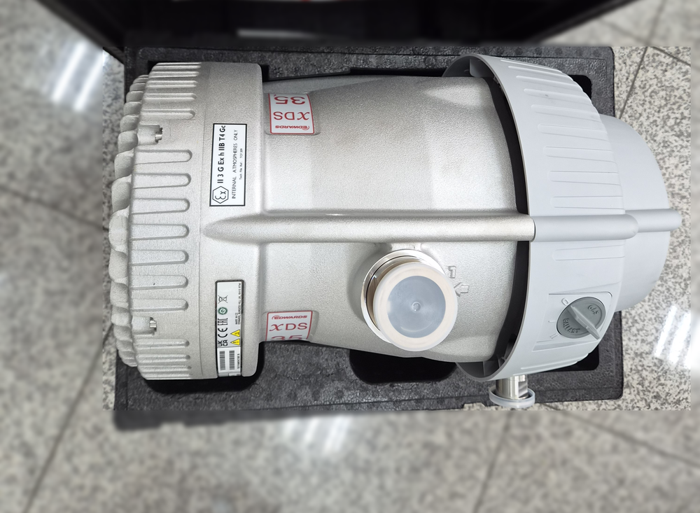
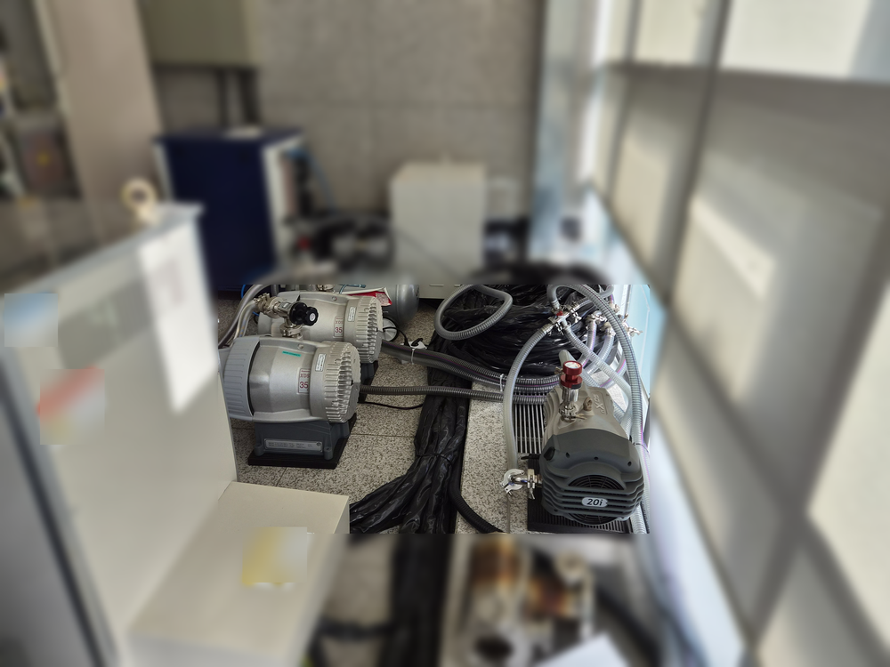
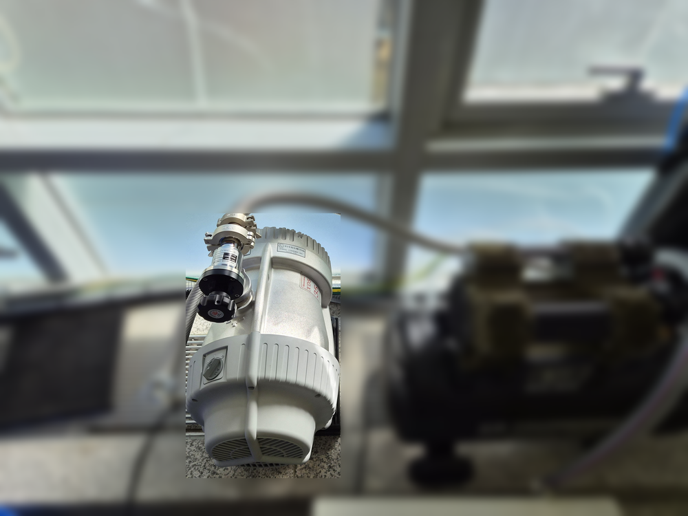
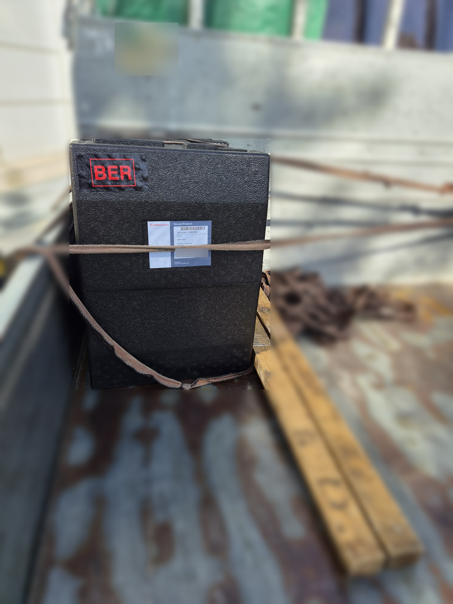

<!-- 수치검증: A항목 9개 확인 / B항목 0개 / C항목 2개 확인 / D항목 4개 확인 / 삭제 1개(허밀틱 실링) / 교체 0개 -->

# 전자현미경 장비 현장에 XDS35i 스크롤펌프 1대 추가 납품 — 같은 모델로 늘릴 때 확인할 것

2026년 10월 28일, 전자현미경 장비를 운영하는 현장에 Edwards XDS35i 드라이 스크롤펌프 1대를 납품했습니다. 기존 펌프를 바꾸는 교체 건이 아니라 새로 들이는 장비에 설치할 펌프를 추가로 구매한 건입니다. 이 현장에서는 이미 XDS35i 2대와 소형 스크롤펌프 nXDS20i 등이 운전 중이고, 이번 1대가 더해지면 XDS35i는 3대가 됩니다.

장비를 늘릴 때는 새 모델을 검토할 수도 있고, 지금 쓰는 모델을 그대로 늘릴 수도 있습니다. 이 글에서는 이번 납품 구성과 XDS35i의 확인된 사양을 정리하고, 같은 모델로 대수를 늘릴 때 미리 확인할 항목을 함께 짚습니다.

## 이미 운전 중인 스크롤펌프 구성

현장 사진을 보면 바닥에 XDS35i 2대가 나란히 놓여 있고, 오른쪽에는 nXDS20i가 있습니다. 세 대 모두 오일을 쓰지 않는 드라이 스크롤 방식이고, 각 펌프 흡입구에는 주름관(플렉시블 호스)이 연결돼 있습니다. 창가 쪽에 따로 설치된 XDS35i도 흡입 쪽에 주름관과 밸브가 달린 상태로 운전 중입니다.

XDS35i는 스마텍 제품 사양표에서 드라이 스크롤(중형 XDS) 계열로 분류되며, 주요 응용 분야로 터보펌프 백킹·연구실·분석기기가 올라 있습니다. nXDS20i는 같은 스크롤 방식의 소형 nXDS 계열입니다. 한 현장 안에서 크기가 다른 스크롤펌프를 함께 쓰는 구성이라, 이번 추가분도 기존과 같은 드라이 스크롤 방식으로 맞춘 셈입니다.

## XDS35i의 확인된 사양

스마텍이 Edwards XDS35i 제품 데이터시트(Publication 3601 0452 01, https://www.edwardsvacuum.com/content/dam/brands/edwards-vacuum/general-vacuum/downloads/dry-scroll-pumps/3601-0452-01-XDS35i-datasheet.pdf)의 기술 데이터 표를 대조한 결과, 표준형 XDS35i의 주요 값은 다음과 같습니다.

- **최대 배기속도**: 35 m³/h
- **도달진공**: 0.01 mbar(전압 기준), 가스 발라스트 1단 사용 시 0.02 mbar
- **수증기 처리량**: 240 g/h
- **접속 규격**: 흡입 NW40, 배기 NW25
- **전원**: 단상 100-120/200-240 V, 50/60 Hz
- **소비전력**: 도달진공에서 440 W, 모터 520 W
- **무게·소음**: 48 kg, 도달진공에서 57 dB(A)
- **운전 온도**: 5~40 ℃

같은 자료에는 구조상 특징도 나옵니다. 베어링 실드가 배기하는 가스와 베어링 윤활 부분을 분리하고, 스마트 모터 드라이브가 과부하 보호와 원격 시작·정지를 맡습니다. 스크롤이 한쪽 면에만 있는 구조라 정비 작업이 짧다는 점도 함께 적혀 있습니다.

운전할 때 알아 둘 점도 있습니다. XDS35i는 대기압에서부터 배기하도록 설계됐지만, 최대 연속 입구 압력(40 mbar)보다 높은 압력에서 오래 운전하면 베어링 수명이 줄 수 있습니다. 또 최대 전력은 짧은 시간만 쓰고, 그 뒤에는 드라이브가 전력과 속도를 줄입니다. 큰 용량을 자주 대기압에서 배기하는 장비라면 이 조건을 미리 확인하는 것이 좋습니다.

## 출고 — 정품 포장 그대로

이번 XDS35i는 Edwards 정품 포장 상자 그대로 화물차에 실어 출고했습니다. 상자 라벨의 파트번호는 A73001983으로, 단상 100-120/200-230V 50/60Hz 표준형입니다. 라벨의 접속 규격 표기도 NW40/NW25로 데이터시트와 같습니다. 상자를 열면 흡입구가 마개로 막힌 상태이고, 펌프 몸체에 모델명 XDS 35 표시가 붙어 있습니다.

## 같은 모델로 대수를 늘릴 때 확인할 것

이미 쓰는 모델을 한 대 더 들이면 배관 접속 부품, 예비 부품, 점검 방법을 기존 펌프와 맞출 수 있습니다. XDS35i는 팁씰·배기 정비 키트(A73001801)를 표준형·C형·NGB형·E형이 함께 씁니다. 다만 같은 이름이라도 주문 변형에 따라 밸브·가스 발라스트 키트가 다르므로, 기존 펌프의 명판에서 정확한 파트번호를 먼저 확인합니다.

지금 쓰시는 장비에 같은 펌프를 한 대 더 붙이려 한다면 아래 항목부터 맞춰 보시길 권합니다.

- 기존 펌프 명판의 파트번호(표준형인지, C·NGB·E 변형인지)
- 새 장비 쪽 접속 규격이 흡입 NW40·배기 NW25와 맞는지
- 설치 위치의 전원(단상 전압)과 주변 온도(5~40 ℃ 범위)
- 배기를 실내에 둘지, 배기 배관으로 밖으로 뺄지
- 장비가 대기압에서 배기하는 빈도와 운전 중 입구 압력

설치 환경에 따라 함께 검토할 수 있는 XDS35i 전용 액세서리도 데이터시트에 정리돼 있습니다. 배기 소음을 줄이는 배기 사일런서(A50597001), 바닥 진동 전달을 줄이는 방진 마운트 4개 세트(A24801408), 흡입·배기 쪽 이물을 거르는 필터(NW40용 A50597806, NW25용 A50597805)입니다. 기존 펌프에 이런 액세서리가 달려 있다면 새 펌프도 같은 구성으로 맞춰 두는 편이 관리하기 수월합니다.

---

Edwards XDS35i(드라이 스크롤, 35 m³/h, 흡입 NW40·배기 NW25)를 전자현미경 장비 현장에 추가 납품한 사례입니다. 제품 사양과 재고·납기는 [XDS35i 제품 페이지](https://www.smartechvacuum.com/products/edwards-xds35i)에서 확인할 수 있습니다.
