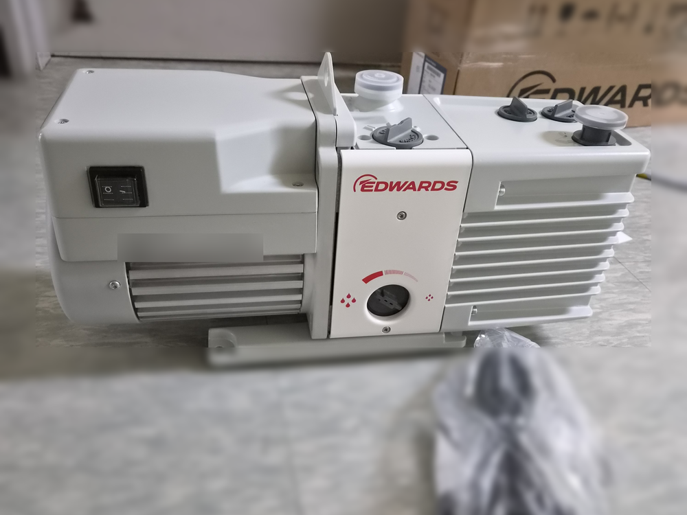
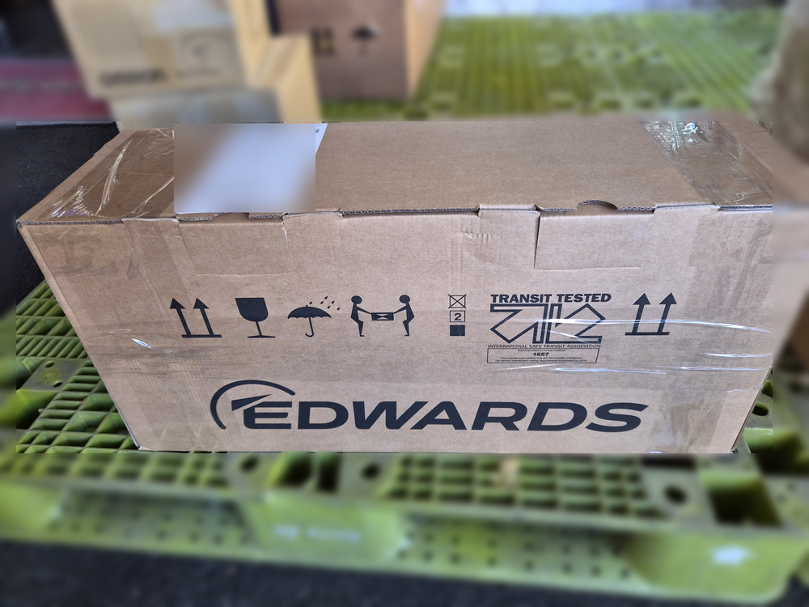
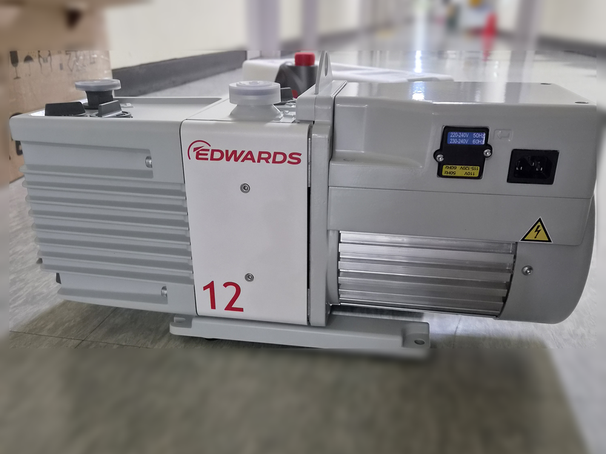

<!-- 수치검증: A항목 8개 확인 / B항목 0개 / C항목 1개 확인 / D항목 4개 확인 / 삭제 0개 / 교체 0개 -->

# 연구실 진공오븐용 RV12 택배 납품 — 받은 뒤 첫 가동 전에 확인할 것

2026년 10월 28일, 한 대학 연구실의 진공오븐에 쓸 Edwards RV12 오일 로터리 펌프 1대를 택배로 납품했습니다. 다음 날 아침 연구실에서 상자를 열고 펌프 앞뒤 사진을 보내 주셨습니다. 이 글은 이번 납품 구성과 함께, 택배로 받은 RV12를 진공오븐에 연결하기 전에 확인할 항목을 순서대로 정리했습니다.

택배로 받으면 개봉부터 첫 가동까지를 연구실에서 직접 하게 됩니다. 오일 주입, 전압 확인, 회전 방향 확인은 처음 한 번만 하면 되지만 빠뜨리면 펌프가 상하거나 성능이 나오지 않을 수 있습니다.

## 진공오븐에 RV12를 쓰는 이유

RV12는 2단 오일 로터리베인 펌프로, 스마텍 제품 사양표의 주요 응용 분야에 진공오븐이 올라 있습니다. 도달진공도는 2.0×10⁻³ mbar이고, 가스 발라스트를 2단(II)으로 열면 수증기를 290 g/h까지 처리할 수 있습니다. 진공오븐은 건조 초기에 시료에서 수분이 많이 나오기 때문에, 수증기를 받아낼 수 있는 펌프가 필요합니다.

배기속도는 전원 주파수에 따라 다릅니다. 스마텍이 Edwards RV3·RV5·RV8·RV12 사용 설명서(A652-01-880)의 기술 데이터 표를 대조한 결과, RV12의 최대 배기속도는 50 Hz 전원에서 12.0 m³/h, 60 Hz 전원에서 14.2 m³/h입니다. 국내 전원은 60 Hz이므로 카탈로그에서 흔히 보는 12 m³/h보다 조금 높은 값이 기준이 됩니다. 권장 오일은 Ultragrade 19이고, RV12의 오일량은 최소 0.65 L에서 최대 1.00 L입니다.

## 받은 뒤 확인 1 — 외관과 보호 마개, 옮기는 방법

상자를 열면 흡입구와 배기구(둘 다 NW25)에 보호 마개가 끼워져 있습니다. 마개를 떼고 몸체에 찍힘이나 깨진 곳이 없는지 먼저 봅니다. 손상이 보이면 사용하지 말고 사진을 찍어 바로 알려 주셔야 합니다. 설명서도 운송 중 손상은 3일 안에 공급처와 운송사에 알리고, 포장재는 확인이 끝날 때까지 버리지 말라고 안내합니다. 바로 설치하지 않을 거라면 마개를 다시 끼워 이물이 들어가지 않게 둡니다.

RV12는 모터와 함께 무게가 약 26.3 kg(오일 제외)입니다. 설명서는 RV8·RV12를 손으로 들지 말고 펌프 위 리프팅 브래킷에 들기 장비를 걸어 옮기도록 안내합니다. 놓는 자리는 단단하고 평평해야 하며, 오일 확인 창·오일 주입구·배출구·모드 선택기·가스 발라스트 조절기에 손이 닿는 방향으로 둡니다.

## 받은 뒤 확인 2 — 전압 표시창

단상 RV12는 110-120 V와 220-240 V 두 가지 전원에 맞춰 바꿔 쓸 수 있는 모터를 씁니다. 모터 커버의 전압 표시창이 지금 연결할 전원과 맞는지 확인하고, 다르면 전압 선택 스위치로 바꾼 뒤 사용합니다. 전압 설정이 맞지 않은 채로 운전하면 모터가 손상될 수 있습니다.

이번에 받은 펌프는 뒷면 표시창에 220-240 V(50 Hz)·230-240 V(60 Hz)가 보이는 상태였습니다. 전원 케이블은 IEC 커넥터로 펌프 뒷면 단자에 꽂습니다.

## 받은 뒤 확인 3 — 오일 주입과 회전 방향

오일 주입구 마개를 열고 Ultragrade 19를 오일 확인 창의 MAX 표시까지 채웁니다. 몇 분 뒤 오일 높이를 다시 확인해 MAX 아래로 내려가 있으면 더 채웁니다. MAX를 넘게 넣었으면 배출구로 덜어냅니다.

오일을 채운 뒤에는 전원 스위치를 몇 초만 켜서 모터 냉각 팬이 덮개의 화살표 방향으로 도는지 봅니다. 방향이 반대면 바로 끄고 문의해야 합니다. 반대로 돌면 펌프와 진공 장치 쪽에 압력이 걸릴 수 있습니다.

## 모드 선택기와 펌프를 껐을 때

RV12 위쪽에는 가스 발라스트 조절기와 별도로 모드 선택기가 있습니다. 고진공(High Vacuum) 모드는 가장 낮은 도달 압력을 얻는 설정이고, 고처리량(High Throughput) 모드는 입구 압력이 높은 상태로 오래 운전해야 할 때 쓰는 설정입니다. 진공오븐처럼 건조 초기에 수분과 가스가 계속 나오는 공정이라면, 초기 배기 구간의 압력이 얼마나 오래 높게 유지되는지 보고 모드를 고릅니다.

펌프를 끄면 흡입 쪽 밸브가 닫혀 공기와 오일이 장비 쪽으로 거꾸로 빨려 들어가는 것을 막습니다. 다만 배기 쪽은 반대입니다. 배기 배관이 막히지 않게 하고, 배기 쪽에 차단 밸브를 달았다면 밸브를 닫은 채 펌프를 돌리지 않도록 합니다.

## 진공오븐에 연결한 뒤 알아 둘 점

- **주변 온도**: 운전 주변 온도는 12~40 ℃입니다. 펌프 온도가 12 ℃보다 낮으면 처음 몇 분은 느리게 돌 수 있어, 겨울철 난방이 약한 실험실이라면 시작 직후 소리가 평소와 달라도 몇 분 지켜봅니다.
- **수증기 배기**: 건조 초기에는 가스 발라스트를 열고, 응축성 증기를 받기 전에 펌프를 데우는 운전이 도움이 됩니다. 순서와 진공도 확인 방법은 [진공 오븐 건조 공정, 진공도는 어떻게 확인할까](https://www.smartechvacuum.com/blog/119)에 정리해 두었습니다.
- **배기 미스트**: 오일 로터리 펌프는 배기구로 오일 미스트가 나옵니다. 실험실 안에 두는 경우 RV12 배기구(NW25)에 맞는 EMF20 미스트필터를 함께 검토합니다.
- **용량이 모자랄 때**: 시료량이나 오븐 크기가 늘어 배기 시간이 길어졌다면 [RV12에서 E2M18로 교체한 진공오븐 사례](https://www.smartechvacuum.com/blog/99)처럼 한 단계 큰 모델을 검토할 수 있습니다.

---

Edwards RV12(2단 오일 로터리베인, 60 Hz 14.2 m³/h, 흡입·배기 NW25)를 대학 연구실 진공오븐용으로 택배 납품한 사례입니다. 제품 사양과 재고·납기는 [RV12 제품 페이지](https://www.smartechvacuum.com/products/edwards-rv12)에서 확인할 수 있습니다.
